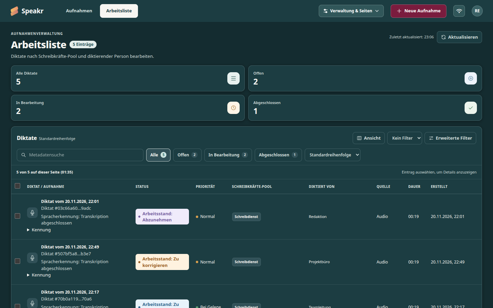
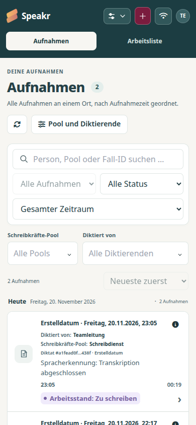
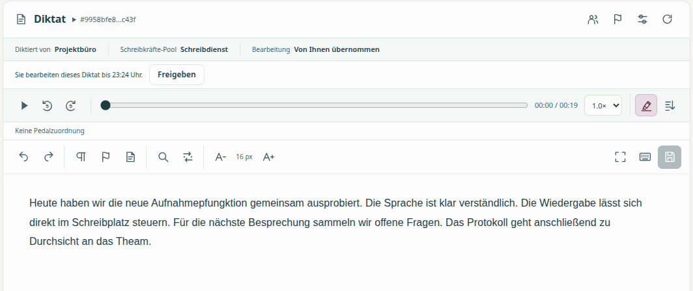
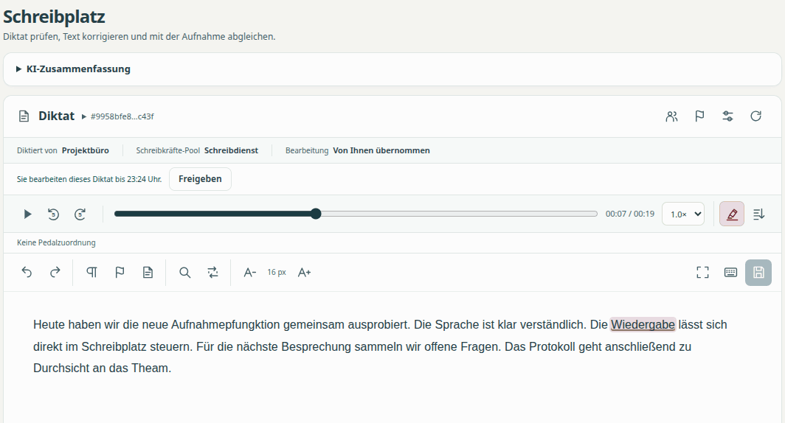

[Deutsch](README.md) · **English**

# Speakr – web dictation for clinics

This independent fork of [Speakr](https://github.com/murtaza-nasir/speakr) (the original project, upstream) is being developed as a web-based replacement for dns.comfort, with a focus on the dns.comfort.pro workflow ([manufacturer](https://www.sonic-labs.net/produkte/dns-comfort-pro)). It is not a product of that manufacturer. Authors dictate in the browser, speech recognition runs on your own infrastructure, and typists play back and correct the text. Review and approval also take place only in the web client, without a native dictation client.

The project is for clinics and development teams who want to evaluate or extend a dictation and transcription workflow in the browser without sending audio to cloud speech recognition. The clinic mode interface is in German (Swiss spelling).

**User manual:** [English](https://joehomeskillet.github.io/speakr/) · [Deutsch](https://joehomeskillet.github.io/speakr/de/)

> [!IMPORTANT]
> **Development status.** This fork is not ready for production use. The project's development rules permit synthetic data only; do not use real patient data. See [Replacement status](#replacement-status) for what has been verified and what is still missing.


*Transcription workspace with correction editor and playback. All data shown is synthetic; the optional AI summary is under evaluation.*

<table>
  <tr>
    <td width="64%" valign="top"></td>
    <td width="36%" valign="top"></td>
  </tr>
  <tr>
    <td>Worklist grouped by typist pool and author. All data shown is synthetic.</td>
    <td>Recordings list on a smartphone. All data shown is synthetic.</td>
  </tr>
</table>

<details>
<summary><strong>Demos</strong> – two short screen clips (silent, synthetic data)</summary>

<br>

Both clips are silent and show synthetic data.



Playing the original audio in the transcription workspace with synchronized word highlighting (8.75 s, 14 recognized words).



Correcting a transcript, saving it and reopening it (9.28 s).

</details>

[Features](#features) · [Replacement status](#replacement-status) · [Evidence and registers](#evidence-and-registers) · [Getting started](#getting-started) · [Contributing](#contributing) · [Credits and license](#credits-and-license)

## Features

The clinic features are active only when `CLINIC_MODE=1` is set. Regardless of this switch, the fork has removed some upstream features, including share links, calendar events, incognito mode, self-registration, password reset by email and several cloud speech recognition providers.

### Recording in the browser

- Under "Neue Aufnahme" (new recording), record in the browser or upload an audio file. A title is required before recording starts.
- "Entwurf sichern" (save draft) stores the recording on the server; "Einreichen" (submit) hands it to the transcription team. By default, audio is not written to browser storage.
- DSS and DS2 dictation files are accepted only with a matching file signature. The original stays unchanged; for recognition, a pinned [dss-codec](https://github.com/hirparak/dss-codec) decodes the file.

### Local speech recognition

- The application expects an OpenAI-compatible speech recognition service, for example Speaches. That service is not part of this repository.
- Configure only local or private recognition services. Speakr checks the configured address of the OpenAI-compatible connector. For other connectors, operators must restrict which network destinations the service can reach.
- Recorded files are transcribed in the background through the existing processing queue. When `TRANSCRIPTION_WORD_TIMESTAMPS=1` is set and the service returns word timings, the transcription workspace highlights the spoken word during playback.
- Optional: [`deployment/gpu-asr-service`](deployment/gpu-asr-service) is an OpenAI-compatible Whisper service on OpenVINO for Intel Arc GPUs. It is not the default.

### Worklist and assignment

- The "Arbeitsliste" (worklist) groups dictations by typist pool and author. It shows counters for "Offen" (open), "In Bearbeitung" (in progress) and "Abgeschlossen" (completed), and supports filtering, sorting and keyboard navigation. Priorities range from "Bei Gelegenheit" (when convenient) to "Dringend" (urgent).
- A dictation can be assigned to a named person. The assignment control appears only when the server returns a list of candidates.
- Editing requires an exclusive, time-limited lock. Saves from an outdated editing state are rejected. Work can be handed back to the transcription team.
- Author pools and typist pools are separate.

### Transcription workspace: playback, correction, version history

- Playback at 0.5× to 2× speed, volume leveling for playback only (the original stays unchanged) and word highlighting with follow-along.
- Foot pedals in keyboard mode: the function or media keys a pedal sends can be mapped to playback actions (play/pause, play while held, rewind, skip forward). WebHID is not used.
- Correction editor with undo and redo, find and replace, font size, full screen and keyboard help. Without recognized text, you can type manually.
- Saving requires holding the current lock; the links between text and audio are preserved.
- Non-destructive audio editing (insert, overwrite, cut, trim) with at least 16 undo steps.
- Transcript revisions are only appended, never overwritten. A later recognition result is stored as a side revision and never replaces a human correction. "Verlauf" (history) shows the order of changes.

### Review, approval, archive

- "Prüfen und Freigeben" (review and approve) shows the reviewed text, audio and context revision. An approval binds exactly that version. If anything changes afterwards, the version must be approved again.
- Approval requires its own grant. Approval, finalization and archiving are separate steps.
- The "Archiv" (archive) lists completed dictations.
- For the state of document output, see [Replacement status](#replacement-status).

### Roles and access scopes

- Access is decided centrally. By default, authors can view, play and edit only their own dictations.
- Every other action needs an explicit grant with a scope: own dictations, specific authors, an author pool or all dictations. Explicit denials always take precedence.
- Only administrators can change grants; identity administrators and all other accounts cannot. Every change is audited. In clinic mode, routes without an entry in the route policy are denied.
- Administration pages appear only after the API confirms the permission.

### Optional

- **Windows file import** ([`apps/windows-import`](apps/windows-import/README.md)): a .NET 10 agent uploads dictation files from explicitly approved folders or removable drives, unchanged, over HTTPS with a client certificate (mTLS). It does not record, play back, edit text or program devices. An author hint from the DS2 file header grants no permissions.
- **AI summary:** Open a dictation and expand “KI-Zusammenfassung”. With editing permission, you can request a summary of the current saved text. When automatic summaries are enabled, this runs once after the first successful recognition of a new dictation. The job checks the permission, text revision and local text model. After a correction, you can request a new summary.
- **Model selection:** Site administrators can view and change the effective local model IDs for CPU recognition, GPU recognition and summaries under “Modellwahl”. New jobs use the saved settings. Changing the summary model leaves the title and chat defaults intact.

## Replacement status

The [project specification](clinic-spec/CLAUDE.md) covers 101 mandatory functions. The original register classifies 56 for the web client, identifies dependencies to verify for 32, and records specific conflicts with the web architecture for 13. All remain in scope. The original register records no direct comparison against dns.comfort for any of the 101 functions. The results below come from tests of the fork with synthetic dictations.

### Verified

Verified in a test environment with synthetic user flows:

- recording and uploading in the web client, and background transcription of recorded files
- local speech recognition, verified on individual synthetic recordings with word timings
- the recordings list and the worklist
- playback and typing in the transcription workspace
- assignment through typist pools and handing work back to the transcription team
- review and approval
- archive

### Partially implemented

- **Windows file import:** tested with a simulated drive; the DS2 author is read from the original file. Acceptance testing with physical devices is missing.
- **Document output in the review and approval path:** the export currently returns status, file name and hash. Downloading the finished file is still missing.
- **Templates:** Administration shows saved DOCX and ODT templates with their version and insertion marker. Users can select a template version in the typing workspace. Inserting its text or exporting into a chosen template remains open.

### Open

Missing features:

- continuous live dictation from the browser microphone with live interim results (not yet wired end to end)
- voice-activated recording start (VOX) in the browser
- reopening an exported audio-and-text package as an editable session
- offline recovery in the normal web client
- read-aloud through synthetic speech output (TTS)
- writing the device author from the web to Philips devices (open web-boundary gap, not implemented)

Real-world acceptance testing:

- device detection and file import on physical Philips LFH9600 and LFH9620 recorders
- a real foot pedal
- a partner hospital information system (KIS); the KIS check currently uses a simulator
- production sign-in services

Behavior gaps:

- desktop dictation into other applications and SpeechLock
- inserting text into documents already open in Word or Writer
- global keyboard shortcuts and a system tray icon
- verified acoustic-profile training from corrections

## Evidence and registers

The public project registers describe the requirements, how they map to the code and which tests are planned. They are not test logs, and they are in German.

- [All 101 mandatory functions](clinic-spec/docs/20_Alle_101_Pflichtfunktionen.md): target behavior of each mandatory function (PAR)
- [PAR parity matrix](clinic-spec/planning/parity-matrix.csv) (also as [JSON](clinic-spec/planning/parity-matrix.json)): maps each mandatory function to modules, reuse and tests
- [Parity and web boundary](clinic-spec/docs/11_Paritaet_und_Webgrenze.md) and [open web-boundary gaps](clinic-spec/planning/web-parity-gaps.json): the 13 open sub-clauses
- [Project specification](clinic-spec/CLAUDE.md): the binding development brief
- [User manual](https://joehomeskillet.github.io/speakr/) (also in [German](https://joehomeskillet.github.io/speakr/de/)): how to use the clinic version

## Getting started

Start from the `main` branch, which holds the published clinic version. `config/docker-compose.example.yml` pulls the upstream Docker Hub image `learnedmachine/speakr`, which does not contain the clinic build. The repository has no compose file for the clinic stack.

### Prerequisites

- Git and Docker; the image build targets `linux/amd64`, because the checksum of the DSS/DS2 decoder applies to that architecture only
- an OpenAI-compatible speech recognition service at a local or private address, for example Speaches
- for the tests without Docker: Python 3.11 and ffmpeg on Linux, and Node.js 18 or 20+ for the JavaScript tests

### Build and run the image

```bash
git clone -b main https://github.com/joehomeskillet/speakr.git
cd speakr
docker build --platform linux/amd64 -t speakr-clinic .
```

The [`Dockerfile`](Dockerfile) installs the dependencies from the lock files with hash checks and builds the DSS/DS2 decoder and the CSS. With `--build-arg LIGHTWEIGHT=1`, you get an image without the embedding dependencies.

The [installation guide](https://joehomeskillet.github.io/speakr/getting-started/installation/) covers local model configuration, networking, startup and the first administrator account. Keep the environment file outside the build directory. PostgreSQL is the primary database in the clinic architecture. Test the installation with a short synthetic recording.

## Contributing

Contributions are welcome. Ongoing development happens on the `dev` branch: branch from `dev` and open pull requests against `dev`.

### Development environment and tests

```bash
python3.11 -m venv venv
venv/bin/pip install --require-hashes --no-deps -r requirements.lock -r requirements-dev.lock
scripts/build_css.sh
venv/bin/python -m pytest tests/ -q -n 4 --dist loadfile -p no:cacheprovider --timeout=120
venv/bin/python -m pytest tests/clinic -q -p no:cacheprovider
venv/bin/python -I clinic-spec/scripts/Verify-SuedhangPackage.py --root clinic-spec
npm ci
npm test
```

- `scripts/build_css.sh` downloads the pinned Tailwind CLI, checks its hash and builds `static/css/tailwind.css`.
- `scripts/clinic_pg_run.sh` runs `tests/clinic` against a throwaway PostgreSQL container (requires Docker).
- The Windows import agent is tested on Windows with the .NET 10 SDK: `dotnet test apps/windows-import/Speakr.Clinic.ImportAgent.sln`.

### Rules

- Put new domain code in `src/clinic/` and tests in `tests/clinic/`. Keep the existing stack (Flask, SQLAlchemy, Vue, Tailwind) and use `ProcessingJob` and `JobQueue` for background work.
- Never weaken existing tests to make a run pass.
- Speech recognition stays local. No native dictation client, no browser extension.
- Use synthetic data only in tests, fixtures, screenshots and issues.
- Do not mark open items in [`clinic-spec/planning/web-parity-gaps.json`](clinic-spec/planning/web-parity-gaps.json) as done.

### License of contributions

Contributions are licensed under the GNU AGPL v3, the license of this repository. If you make a modified version available to others over a network, you must offer its users the source code of that version (section 13 of the [license](LICENSE)). Existing copyright and license notices stay in place.

For contributions to this fork, see the [contribution guide](CONTRIBUTING.md). Contributions to the original project follow its [upstream contribution terms](https://github.com/murtaza-nasir/speakr/blob/48d3018fb7d80b77f897bedd86bcc89b5034d1f5/CONTRIBUTING.md) and [Contributor License Agreement](CLA.md).

## Credits and license

- This repository is a fork of [Speakr](https://github.com/murtaza-nasir/speakr) (the original project, upstream), version v0.11.1, upstream commit `48d3018fb7d80b77f897bedd86bcc89b5034d1f5`. Recording, transcription integration, processing queue, user management and interface build on the work of the Speakr project. The fork has removed some upstream features (see [Features](#features)).
- Fork: [github.com/joehomeskillet/speakr](https://github.com/joehomeskillet/speakr), branch `main` (published clinic version) and branch `dev` (ongoing development).
- License: GNU Affero General Public License, Version 3 (AGPL-3.0), see [`LICENSE`](LICENSE).
- The original project describes its [separate commercial licensing offer](https://github.com/murtaza-nasir/speakr/blob/48d3018fb7d80b77f897bedd86bcc89b5034d1f5/README.md). Direct enquiries about that offer to the upstream project. The clinic changes published here are covered by the AGPL v3 linked above.
- The [clinic handbook](https://joehomeskillet.github.io/speakr/) documents this fork. The [sources page](docs/sources.md) links to the pinned original documentation. The upstream Docker Hub image contains the original project’s build.
- DSS/DS2 decoding uses [dss-codec](https://github.com/hirparak/dss-codec), pinned to a fixed commit in the Dockerfile.
- dns.comfort and dns.comfort.pro are products of their manufacturer. The names are used here only to describe the functional goal.
