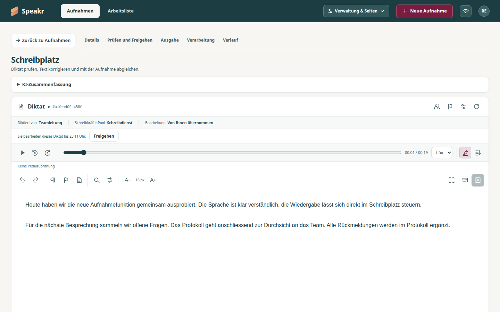
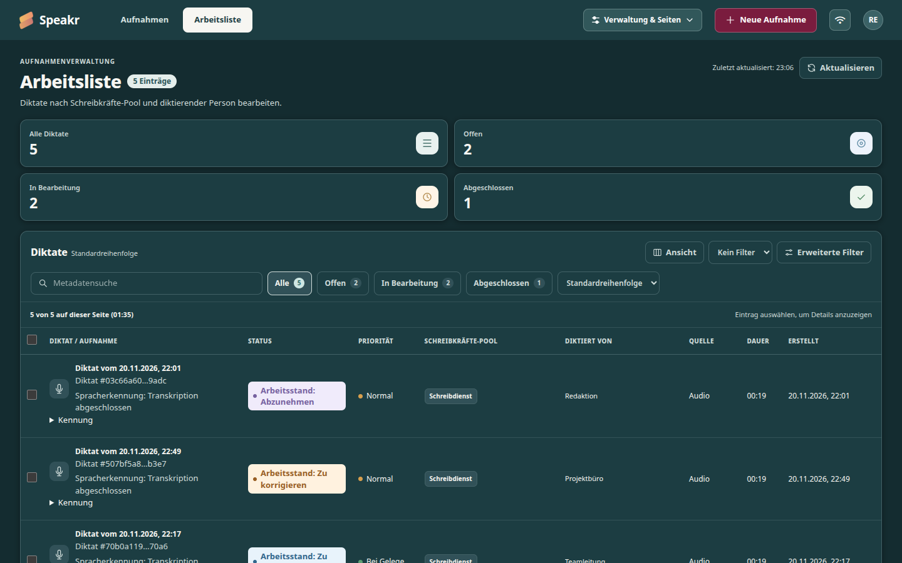
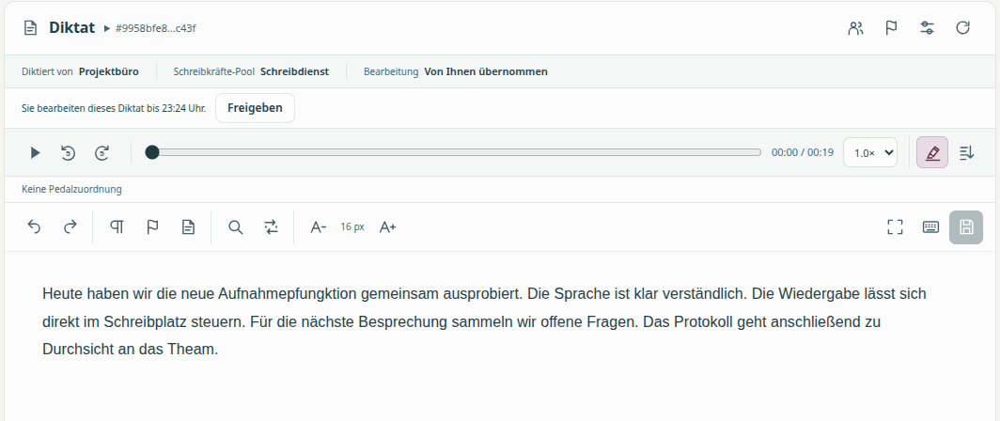

**Deutsch** · [English](README.en.md)

# Speakr – Web-Diktat für Kliniken

Dieser unabhängige Fork von [Speakr](https://github.com/murtaza-nasir/speakr) (Originalprojekt, Upstream) wird als webbasierte Ablösung für dns.comfort entwickelt, mit Fokus auf den Arbeitsablauf von dns.comfort.pro ([Hersteller](https://www.sonic-labs.net/produkte/dns-comfort-pro)). Er ist kein Produkt dieses Herstellers. Diktierende nehmen im Browser auf, die Spracherkennung läuft auf eigener Infrastruktur, und der Schreibdienst hört ab und korrigiert. Auch Prüfung und Freigabe erfolgen ausschliesslich im Webclient, ohne nativen Diktatclient.

Das Projekt richtet sich an Kliniken und Entwicklungsteams, die einen Diktat- und Schreibdienstablauf im Browser erproben oder weiterentwickeln wollen, ohne Audio an Cloud-Spracherkennung zu senden. Die Oberfläche des Klinikmodus ist deutschsprachig (Schweizer Schreibweise).

**Benutzerhandbuch:** [Deutsch](https://joehomeskillet.github.io/speakr/de/) · [English](https://joehomeskillet.github.io/speakr/)

**Windows-Dateiimport (x64) · unsignierte Testversion:** [EXE herunterladen](https://github.com/joehomeskillet/speakr/releases/download/windows-import-v0.11.1-preview.1/Speakr-Import-win-x64-preview.exe) · [SHA-256 prüfen und Serveradresse einrichten](https://joehomeskillet.github.io/speakr/de/user-guide/companion-apps/#windows-importagent)

<details>
<summary>Windows-Importagent einrichten</summary>

| HTTPS-Adresse der Klinik eingeben | Adresse nach erneutem Öffnen |
| --- | --- |
|  |  |

</details>

> [!IMPORTANT]
> **Entwicklungsstand.** Der Fork ist nicht für den Produktivbetrieb freigegeben. Die Entwicklungsvorgaben des Projekts erlauben nur synthetische Daten; verwenden Sie keine echten Patientendaten. Was belegt ist und was fehlt, steht unter [Stand der Ablösung](#stand-der-ablösung).



*Schreibplatz mit Korrektureditor und Wiedergabe. Alle gezeigten Daten sind synthetisch.*

<table>
  <tr>
    <td width="64%" valign="top"></td>
    <td width="36%" valign="top"></td>
  </tr>
  <tr>
    <td>Arbeitsliste nach Schreibkräfte-Pool und Autor. Alle gezeigten Daten sind synthetisch.</td>
    <td>Aufnahmenliste auf dem Smartphone. Alle gezeigten Daten sind synthetisch.</td>
  </tr>
</table>

<details>
<summary><strong>Demos</strong> – zwei kurze Bildschirmclips (stumm, synthetische Daten)</summary>

<br>

Beide Clips sind stumm und zeigen synthetische Daten.



Abspielen des Originalaudios im Schreibplatz mit mitlaufender Wortmarkierung (8,75 s, 14 erkannte Wörter).


Korrigieren, Speichern und erneutes Öffnen eines Transkripts (9,28 s).

</details>

[Funktionen](#funktionen) · [Stand der Ablösung](#stand-der-ablösung) · [Nachweise und Register](#nachweise-und-register) · [Erste Schritte](#erste-schritte) · [Mitwirken](#mitwirken) · [Herkunft und Lizenz](#herkunft-und-lizenz)

## Funktionen

Die Klinikfunktionen sind nur aktiv, wenn `CLINIC_MODE=1` gesetzt ist. Unabhängig von diesem Schalter hat der Fork einzelne Upstream-Funktionen entfernt, darunter Freigabelinks, Kalenderereignisse, den Inkognito-Modus, die Selbstregistrierung, die Passwortrücksetzung per E-Mail und mehrere Cloud-Spracherkennungsanbieter. Ausserdem werden in diesem Fork nicht angeboten: E-Mail jeder Art (kein SMTP, keine Benachrichtigungsmails, kein EML-Download; Benachrichtigungen erscheinen nur in der Anwendung), Windows-Einmalanmeldung (kein IWA, Negotiate oder Kerberos), PDF- oder Bildanhänge, Dokumentimport und Citrix/RDP/ICA. Die Anmeldung ist die normale Web-Anmeldung mit lokalen Konten.

### Aufnahme im Browser

- Unter „Neue Aufnahme“ im Browser aufnehmen oder eine Audiodatei hochladen. Vor dem Start ist ein Titel erforderlich.
- „Entwurf sichern“ legt die Aufnahme auf dem Server ab, „Einreichen“ übergibt sie an den Schreibdienst. Audio wird standardmässig nicht im Browserspeicher abgelegt.
- DSS- und DS2-Diktatdateien werden nur mit passender Dateikennung angenommen. Das Original bleibt unverändert; für die Erkennung dekodiert ein fest gepinnter [dss-codec](https://github.com/hirparak/dss-codec) die Datei.

### Lokale Spracherkennung

- Erwartet wird ein OpenAI-kompatibler Spracherkennungsdienst, zum Beispiel Speaches. Er ist nicht Teil dieses Repositorys.
- Verwenden Sie ausschliesslich lokale oder private Erkennungsdienste. Beim OpenAI-kompatiblen Anschluss prüft Speakr die konfigurierte Adresse. Für andere Anschlüsse muss der Betrieb die erlaubten Netzwerkziele begrenzen.
- Aufgenommene Dateien werden im Hintergrund über die bestehende Verarbeitungswarteschlange transkribiert. Ist `TRANSCRIPTION_WORD_TIMESTAMPS=1` gesetzt und liefert der Dienst Wortzeiten, markiert der Schreibplatz beim Abspielen das gesprochene Wort.
- Optional: [`deployment/gpu-asr-service`](deployment/gpu-asr-service) ist ein OpenAI-kompatibler Whisper-Dienst auf OpenVINO für Intel-Arc-GPUs. Er ist nicht die Standardeinstellung.

### Arbeitsliste und Zuweisung

- Die „Arbeitsliste“ ordnet Diktate nach Schreibkräfte-Pool und Autor. Sie zeigt Zähler für „Offen“, „In Bearbeitung“ und „Abgeschlossen“ und bietet Filter, Sortierung und Tastaturnavigation. Prioritäten reichen von „Bei Gelegenheit“ bis „Dringend“.
- Ein Diktat lässt sich namentlich zuweisen. Die Zuweisungsauswahl erscheint nur, wenn der Server eine Kandidatenliste liefert.
- Bearbeiten setzt eine exklusive, zeitlich begrenzte Übernahme voraus. Speichern aus einem veralteten Bearbeitungsstand wird abgewiesen. Die Bearbeitung lässt sich an den Schreibdienst zurückgeben.
- Autorenpools und Schreibkräfte-Pools sind getrennt.

### Schreibplatz: Abhören, Korrigieren, Versionen

- Wiedergabe mit 0,5- bis 2-facher Geschwindigkeit, Lautstärkeausgleich nur für die Wiedergabe (das Original bleibt unverändert) und Wortmarkierung mit Mitverfolgen.
- Fusspedale im Tastaturmodus: Die Funktions- oder Medientasten, die ein Pedal sendet, lassen sich Wiedergabeaktionen zuordnen (Abspielen/Pause, Abspielen bei gedrückter Taste, Zurück, Vor). WebHID wird nicht verwendet.
- Korrektureditor mit Rückgängig und Wiederholen, Suchen und Ersetzen, Schriftgrösse, Vollbild und Tastaturhilfe. Ohne Erkennungstext lässt sich manuell schreiben.
- Speichern setzt die aktuelle Übernahme voraus; die Verknüpfungen zwischen Text und Audio bleiben erhalten.
- Nicht destruktive Audiobearbeitung (Einfügen, Überschreiben, Ausschneiden, Kürzen) mit mindestens 16 Rückgängig-Schritten.
- Textrevisionen werden nur angehängt, nie überschrieben. Ein späteres Erkennungsergebnis wird als Nebenrevision gespeichert und ersetzt keine menschliche Korrektur. „Verlauf“ zeigt die Reihenfolge der Änderungen.

### Prüfen, Freigeben, Archiv

- „Prüfen und Freigeben“ zeigt die geprüfte Text-, Audio- und Kontextrevision. Eine Freigabe bindet genau diese Fassung. Ändert sich danach etwas, ist die Fassung erneut abzunehmen.
- Freigeben erfordert eine eigene Berechtigung. Freigeben, Fertigstellen und Archivieren sind getrennte Schritte.
- Das „Archiv“ listet abgeschlossene Diktate.
- Zum Stand der Dokumentausgabe siehe [Stand der Ablösung](#stand-der-ablösung).

### Rollen und Sichtbereiche

- Der Zugriff wird zentral entschieden. Diktierende sehen, hören und bearbeiten standardmässig nur eigene Diktate.
- Jede weitere Aktion braucht eine ausdrückliche Berechtigung mit Geltungsbereich: eigene Diktate, bestimmte Diktierende, ein Autorenpool oder alle. Ausdrückliche Verweigerungen gehen immer vor.
- Berechtigungen ändern nur Administratoren; Identitätsadministratoren und alle anderen Konten können das nicht. Jede Änderung wird protokolliert. Routen ohne Eintrag in der Routenrichtlinie sind im Klinikmodus gesperrt.
- Verwaltungsseiten erscheinen nur, wenn die API die Berechtigung bestätigt.

### Optional

- **Windows-Dateiimport** ([EXE herunterladen](https://github.com/joehomeskillet/speakr/releases/download/windows-import-v0.11.1-preview.1/Speakr-Import-win-x64-preview.exe) · [`apps/windows-import`](apps/windows-import/README.md)): Ein .NET-10-Agent lädt Diktatdateien aus ausdrücklich freigegebenen Ordnern oder Wechseldatenträgern unverändert über HTTPS mit Client-Zertifikat (mTLS) hoch. Er nimmt nicht auf, spielt nicht ab, bearbeitet keinen Text und programmiert keine Geräte. Ein Autorenhinweis aus dem DS2-Dateikopf gewährt keine Rechte.
- **KI-Zusammenfassung:** Öffnen Sie das Diktat und wählen Sie „KI-Zusammenfassung“. Mit Bearbeitungsrecht können Sie die aktuelle gespeicherte Textfassung zusammenfassen lassen. Bei aktivierter Automatik startet dies einmal nach der ersten erfolgreichen Erkennung eines neuen Diktats. Der Auftrag prüft Fachrecht, Textrevision und lokales Textmodell. Eine spätere Korrektur lässt sich auf Wunsch neu zusammenfassen.
- **Modellwahl:** Site-Administratoren sehen und ändern unter „Modellwahl“ die wirksamen lokalen Modellkennungen für CPU-Erkennung, GPU-Erkennung und Zusammenfassungen. Neue Aufträge verwenden die gespeicherten Werte. Die Wahl des Zusammenfassungsmodells ändert weder den Titel- noch den Chatstandard.

## Stand der Ablösung

Der [Projektauftrag](clinic-spec/CLAUDE.md) umfasst 101 Pflichtfunktionen. Das ursprüngliche Register ordnet 56 dem Webclient zu und nennt bei 32 eine zu prüfende Abhängigkeit. Bei 13 weiteren stehen Teilanforderungen im Konflikt mit der Webarchitektur. Alle bleiben im Umfang. Im Originalregister ist bisher für keine der 101 Funktionen ein direkter Vergleich mit dns.comfort protokolliert. Die folgenden Ergebnisse stammen aus Tests des Forks mit synthetischen Diktaten.

Hinzu kommen weitere Klinik-, Identitäts- und Grenzanforderungen. Keine Pflichtfunktion ist gestrichen; die 13 widersprüchlichen Teilklauseln bleiben offen. Eine 1:1-Gleichwertigkeit mit dns.comfort wird nicht behauptet, solange Webgrenzen und vollständige Referenzvergleiche offen sind. Die zugehörigen Register sind unter [Nachweise und Register](#nachweise-und-register) verlinkt.

### Belegt

Im Testbetrieb mit synthetischen Benutzerabläufen:

- Aufnahmen und Uploads im Webclient sowie Transkription aufgenommener Dateien im Hintergrund
- lokale Spracherkennung, geprüft an einzelnen synthetischen Aufnahmen mit Wortzeiten
- Aufnahmenliste und Arbeitsliste
- Abhören und Schreiben im Schreibplatz
- Zuweisung über Schreibkräfte-Pools und Rückgabe an den Schreibdienst
- Prüfen und Freigeben
- Archiv

### Teilweise umgesetzt

- **Windows-Dateiimport:** mit einem simulierten Laufwerk getestet; der DS2-Autor wird aus der Originaldatei gelesen. Die Abnahme mit physischen Geräten fehlt.
- **Dokumentausgabe im Prüf- und Freigabeweg:** Der Export liefert derzeit Status, Dateiname und Hash. Das Herunterladen der fertigen Datei fehlt noch.
- **Vorlagen:** Die Verwaltung zeigt gespeicherte DOCX- und ODT-Vorlagen mit Version und Einfügemarke. Im Schreibplatz lässt sich eine Vorlagenversion auswählen. Das Einfügen des Vorlagentextes und die Ausgabe in eine gewählte Vorlage bleiben offen.

### Offen

Fehlende Softwarefunktionen:

- fortlaufendes Live-Diktat über das Browsermikrofon mit laufenden Zwischenergebnissen (noch nicht durchgehend angebunden)
- sprachgesteuerter Aufnahmestart (VOX) im Browser
- erneutes Laden eines exportierten Pakets aus Audio und Text als bearbeitbare Sitzung
- Offline-Wiederherstellung im normalen Webclient
- Vorlesen per synthetischer Sprachausgabe (TTS)
- Schreiben des Geräteautors aus dem Web auf Philips-Geräte (offene Webgrenze, nicht umgesetzt)

Abnahme in realer Umgebung:

- Erkennung und Dateiimport an physischen Philips-Geräten LFH9600 und LFH9620
- echtes Fusspedal
- Partner-KIS (Krankenhausinformationssystem); die Anbindung ist rein lesend (das KIS öffnet Speakr mit einer Fall-ID als URL-Kontext, nichts wird an das KIS geliefert oder zurückgeschrieben), die KIS-Prüfung verwendet derzeit einen Simulator
- produktive Anmeldedienste

Verhaltenslücken:

- Desktop-Diktat in andere Anwendungen und SpeechLock
- Einfügen in bereits geöffnete Word- oder Writer-Dokumente
- globale Tastenkürzel und Symbol im Infobereich (Tray)
- bestätigtes Training akustischer Profile aus Korrekturen

## Nachweise und Register

Die öffentlichen Projektregister beschreiben Anforderungen, ihre Zuordnung und die vorgesehenen Tests. Sie sind keine Testprotokolle und deutschsprachig. Ihre Statusfelder (`not_started`, `not_run`) stammen aus der Spezifikation vom 17.11.2026; sie sind kein aktueller Testnachweis. Den hier beschriebenen Stand fasst [Stand der Ablösung](#stand-der-ablösung) zusammen.

Der Fork hat eigene [GitHub-CI-Prüfungen](.github/workflows/test.yml), darunter Python-Tests auf SQLite und PostgreSQL sowie Browserprüfungen. Die vorhandene [Forgejo-Konfiguration](.forgejo/workflows/test.yml) ist davon getrennt. Workflow-Dateien beschreiben Prüfungen, belegen aber keinen erfolgreichen Lauf. Auch bestandene synthetische Tests ersetzen weder physische Geräteabnahmen noch den vollständigen Vergleich mit dns.comfort.

- [Alle 101 Pflichtfunktionen](clinic-spec/docs/20_Alle_101_Pflichtfunktionen.md): Sollverhalten jeder Pflichtfunktion (PAR)
- [PAR-Paritätsmatrix](clinic-spec/planning/parity-matrix.csv) (auch als [JSON](clinic-spec/planning/parity-matrix.json)): Zuordnung jeder Pflichtfunktion zu Modulen, Wiederverwendung und Tests
- [Parität und Webgrenze](clinic-spec/docs/11_Paritaet_und_Webgrenze.md) und [offene Webgrenzen](clinic-spec/planning/web-parity-gaps.json): die 13 offenen Teilklauseln
- [Projektspezifikation](clinic-spec/CLAUDE.md): verbindlicher Entwicklungsauftrag
- [Benutzerhandbuch](https://joehomeskillet.github.io/speakr/de/) (auch auf [Englisch](https://joehomeskillet.github.io/speakr/)): Bedienung der Klinikversion

## Erste Schritte

Ausgangspunkt ist der Branch `main` mit der veröffentlichten Klinikversion. `config/docker-compose.example.yml` bezieht das Upstream-Image `learnedmachine/speakr` von Docker Hub; es enthält keinen Klinik-Build. Eine Compose-Datei für den Klinik-Stack liegt nicht im Repository.

### Voraussetzungen

- Git und Docker; der Image-Build ist für `linux/amd64` ausgelegt, weil der Prüfwert des DSS/DS2-Decoders nur für diese Architektur gilt
- ein OpenAI-kompatibler Spracherkennungsdienst unter einer lokalen oder privaten Adresse, zum Beispiel Speaches
- für die Tests ohne Docker: Python 3.11 und ffmpeg unter Linux sowie Node.js 18 oder ab 20 für die JavaScript-Tests

### Image bauen und starten

```bash
git clone -b main https://github.com/joehomeskillet/speakr.git
cd speakr
docker build --platform linux/amd64 -t speakr-clinic .
```

Das [`Dockerfile`](Dockerfile) installiert die Abhängigkeiten aus den Lock-Dateien mit Hash-Prüfung und baut den DSS/DS2-Decoder sowie das CSS. Mit `--build-arg LIGHTWEIGHT=1` entsteht ein Image ohne die Embedding-Abhängigkeiten.

Die [Installationsanleitung](https://joehomeskillet.github.io/speakr/de/getting-started/installation/) führt durch lokale Modellauswahl, Netzwerk, Start und das erste Administratorkonto. Legen Sie die Umgebungsdatei ausserhalb des Build-Verzeichnisses ab. PostgreSQL ist die führende Datenbank der Klinikarchitektur. Weitere Optionen der Spracherkennung stehen in [`config/env.transcription.example`](config/env.transcription.example). Testen Sie die neue Installation mit einer kurzen synthetischen Aufnahme.

## Mitwirken

Beiträge sind willkommen. Die laufende Entwicklung findet auf dem Branch `dev` statt: Zweigen Sie von `dev` ab und eröffnen Sie Pull Requests auf `dev`.

### Entwicklungsumgebung und Tests

```bash
python3.11 -m venv venv
venv/bin/pip install --require-hashes --no-deps -r requirements.lock -r requirements-dev.lock
scripts/build_css.sh
venv/bin/python -m pytest tests/ -q -n 4 --dist loadfile -p no:cacheprovider --timeout=120
venv/bin/python -m pytest tests/clinic -q -p no:cacheprovider
venv/bin/python -I clinic-spec/scripts/Verify-SuedhangPackage.py --root clinic-spec
npm ci
npm test
```

- `scripts/build_css.sh` lädt die gepinnte Tailwind-CLI, prüft ihren Hash und erzeugt `static/css/tailwind.css`.
- `scripts/clinic_pg_run.sh` führt `tests/clinic` gegen einen temporären PostgreSQL-Container aus (Docker erforderlich).
- Der Windows-Importagent wird unter Windows mit dem .NET-10-SDK getestet: `dotnet test apps/windows-import/Speakr.Clinic.ImportAgent.sln`.
- Bekanntes Problem: `tests/test_audit_log_coverage.py::test_no_marker_reaches_a_row_or_a_fallback_line` kann im parallelen Lauf reihenfolgeabhängig fehlschlagen und besteht einzeln.

### Regeln

- Legen Sie neue Fachlogik unter `src/clinic/` und Tests unter `tests/clinic/` ab. Behalten Sie den bestehenden Stack bei (Flask, SQLAlchemy, Vue, Tailwind) und nutzen Sie für Hintergrundarbeit `ProcessingJob` und `JobQueue`.
- Schwächen Sie bestehende Tests nie ab, um einen Lauf grün zu machen.
- Spracherkennung bleibt lokal. Kein nativer Diktatclient, keine Browsererweiterung.
- Verwenden Sie in Tests, Fixtures, Screenshots und Issues ausschliesslich synthetische Daten.
- Markieren Sie offene Punkte in [`clinic-spec/planning/web-parity-gaps.json`](clinic-spec/planning/web-parity-gaps.json) nicht als erledigt.

### Lizenz von Beiträgen

Beiträge stehen unter der GNU AGPL v3, der Lizenz dieses Repositorys. Wer eine geänderte Fassung über ein Netzwerk für andere bereitstellt, muss deren Nutzenden den Quellcode dieser Fassung anbieten (Abschnitt 13 der [Lizenz](LICENSE)). Bestehende Urheber- und Lizenzhinweise bleiben erhalten.

Für Beiträge zu diesem Fork siehe [Beitragsleitfaden](CONTRIBUTING.md). Für Beiträge an das Originalprojekt gelten dessen [Beitragsbedingungen](https://github.com/murtaza-nasir/speakr/blob/48d3018fb7d80b77f897bedd86bcc89b5034d1f5/CONTRIBUTING.md) und [Contributor License Agreement](CLA.md).

## Herkunft und Lizenz

- Dieses Repository ist ein Fork von [Speakr](https://github.com/murtaza-nasir/speakr) (Originalprojekt, Upstream), Version v0.11.1, Upstream-Commit `48d3018fb7d80b77f897bedd86bcc89b5034d1f5`. Aufnahme, Transkriptionsanbindung, Verarbeitungswarteschlange, Benutzerverwaltung und Oberfläche bauen auf der Arbeit des Speakr-Projekts auf. Einzelne Upstream-Funktionen hat der Fork entfernt (siehe [Funktionen](#funktionen)).
- Fork: [github.com/joehomeskillet/speakr](https://github.com/joehomeskillet/speakr), Branch `main` (veröffentlichte Klinikversion) und Branch `dev` (laufende Entwicklung).
- Lizenz: GNU Affero General Public License, Version 3 (AGPL-3.0), siehe [`LICENSE`](LICENSE).
- Das Originalprojekt beschreibt seine [separate kommerzielle Lizenzierung](https://github.com/murtaza-nasir/speakr/blob/48d3018fb7d80b77f897bedd86bcc89b5034d1f5/README.md). Anfragen zu dessen Angebot richten Sie an das Originalprojekt. Für die hier veröffentlichten Klinikänderungen gilt die oben verlinkte AGPL v3.
- Das [Klinikhandbuch](https://joehomeskillet.github.io/speakr/de/) dokumentiert diesen Fork. Die [Quellenübersicht](docs/de/sources.md) verlinkt die auf einen Commit fixierte Originaldokumentation. Das Docker-Hub-Image des Originalprojekts enthält dessen eigene Fassung.
- Die DSS/DS2-Dekodierung nutzt [dss-codec](https://github.com/hirparak/dss-codec), im Dockerfile auf einen festen Commit gepinnt.
- dns.comfort und dns.comfort.pro sind Produkte ihres Herstellers. Die Namen beschreiben hier nur das Funktionsziel.
