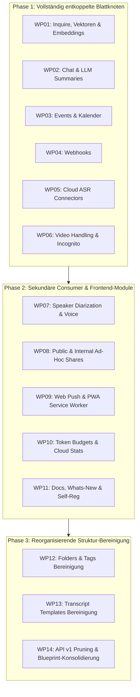

# Feature-Inventar und Entfernungsanalyse: Speakr v0.11.1 Fork (clinic/main)

Dieses Dokument analysiert den vollständigen Upstream-Funktionsumfang von Speakr (Commit `48d3018fb7d80b77f897bedd86bcc89b5034d1f5`) anhand von `clinic-evidence/upstream-map.json`, `clinic-evidence/route-map.json` (307 Routen), 39 Datenbanktabellen und 329 Testdateien. Jede Komponente wird gegen die 101 Pflichtfunktionen (PAR), die Klinik-Anforderungen (`clinic-spec/planning/requirements.json`) sowie die Architekturverträge (`CLAUDE.md`, Docs 02, 10–15) abgeglichen.

Entscheidungen:
- **KEEP**: Für das Diktatprodukt unverändert oder minimal integriert nötig.
- **ADAPT**: Mechanismus bleibt erhalten, wird aber auf klinische Semantik (Revisionsmodell, Poolrechte, lokale ASR) umgebaut.
- **REMOVE**: Entfällt vollständig (Code, Routen, Models, Templates, JS, Tests).

---

## 1. Feature-Inventar (34 Fachbereiche)

### 1. Recording Upload
- **Entscheidung**: **ADAPT** (PAR-IMP-007, PAR-REC-008, Doc 12).
- **Dateien/Routen**: `src/api/recordings.py` (`/upload`, `/upload/cancel`, `/upload/join/<group>`), `src/services/recording_ingestion.py`, `src/services/upload_conversion.py`, `src/services/upload_join.py`, `src/utils/audio_conversion.py`. Frontend: `static/js/modules/composables/upload.js`.
- **Models/Tabellen**: `client_upload`, `upload_join_part`.
- **Templates**: `templates/includes/upload-disclaimer-modal.html`.
- **Tests**: `tests/test_recording_ingestion.py`, `tests/test_sliced_file_upload.py`, `tests/test_upload_conversion_job.py`, `tests/test_upload_join.py`.
- **Reshape**: Bereinigung um Video-Extraktion und Multi-Part-Client-Joins; strikte Anbindung an klinische Metadaten-Ingestion (`src/clinic/ingest/`).
- **Kopplung**: `Recording`-Erzeugung; `ProcessingJob`-Initialisierung.

### 2. Browser Recorder
- **Entscheidung**: **ADAPT** (PAR-REC-001..007, PAR-LIVE-001, Doc 13).
- **Dateien/Routen**: `static/js/modules/composables/audio.js`.
- **Models/Tabellen**: Keine direkten DB-Tabellen (Client-MediaRecorder).
- **Templates**: Eingebettet in `templates/index.html`.
- **Tests**: `tests/test_asr_voice_recorder_upload.py`, `static/js/modules/composables/audio.test.js`.
- **Reshape**: Ergänzung um Voice-Activation (VAD, Schwellwerte, PAR-REC-004), Vor-/Nachlaufpegel (PAR-REC-005) und nichtdestruktives 16-stufiges Audio-Undo (Doc 13).

### 3. Recording Sessions
- **Entscheidung**: **ADAPT** (Doc 13 Abs. 1, PAR-REC-008, PAR-LIVE-003).
- **Dateien/Routen**: `src/api/recording_sessions.py` (`/upload/session/*`), `static/js/modules/db/server-recording-sessions.js`, `static/js/modules/db/recording-persistence.js`.
- **Models/Tabellen**: `recording_session`.
- **Tests**: `tests/test_recording_sessions.py`, `tests/test_session_links.py`.
- **Reshape**: Anbindung an monotone Sequenznummern, Generationswechsel und `dictation_id` zur Phrasen- und Entwurfssicherung.

### 4. Transcription Connectors (ASR)
- **Entscheidung**: **ADAPT** für lokale ASR; **REMOVE** für alle Cloud-Konnektoren (PAR-ASR-001, CLAUDE.md Abs. 1, Doc 02).
- **Dateien/Routen**:
  - *KEEP/ADAPT*: `src/services/transcription/base.py`, `registry.py`, `connectors/asr_endpoint.py` (angepasst auf lokale Speaches-/Whisper-kompatible HTTP-API).
  - *REMOVE*: `connectors/alibaba_funasr.py`, `assemblyai.py`, `azure_openai_transcribe.py`, `mistral.py`, `mossland.py`, `openai_transcribe.py`, `openai_whisper.py`, `openasr.py`, `tencent_asr.py`, `vibevoice.py`, `provider_tasks.py`.
- **Models/Tabellen**: Keine eigenen Tabellen (verwaltet via `ProcessingJob`).
- **Tests (Remove)**: `tests/test_cov_assemblyai_connector.py`, `tests/test_funasr.py`, `tests/test_openasr_connector.py`, `tests/test_tencent_asr.py`, `tests/test_connector_architecture.py`.
- **Kopplung**: `src/tasks/processing.py` ruft Konnektoren über `registry.py` auf.

### 5. Speaker Diarization und Voice Profiles
- **Entscheidung**: **REMOVE** (Klinikdiktat ist 1-Sprecher-Autorendiktat; PAR-ADM-001/006 steuert Autor/Schreibkraft, keine Meeting-Diarisierung).
- **Dateien/Routen**: `src/api/speakers.py` (14 Routen: `/speakers/*`), `src/services/speaker*.py` (8 Dateien), `src/services/voice_*.py` (3 Dateien), `src/models/speaker_snippet.py`, `src/models/voice.py`. Frontend: `static/js/modules/composables/speakers.js`, `speaker-modal.js`.
- **Models/Tabellen**: `speaker`, `speaker_snippet`, `speaker_voice_sample`, `voice_embedding_space`.
- **Templates**: `templates/modals/speaker-modal.html`, `add-speaker-modal.html`, `edit-participants-modal.html`, Tab in `account.html`.
- **Tests**: 15 Testdateien, u.a. `tests/test_api_v1_speakers.py`, `tests/test_voice_profiles.py`, `tests/test_diarization_label_normalization.py`, `tests/test_speaker_merge_renames.py`.
- **Kopplung**: `Recording.speaker_snippets` und `User.speakers` müssen im SQLAlchemy-Mapping entfernt werden.

### 6. ASR / Transcript Editor
- **Entscheidung**: **ADAPT** (PAR-COR-001..010, PAR-LIVE-005, Doc 13).
- **Dateien/Routen**: `static/js/modules/composables/asr-editor.js`, `static/js/modules/asr-editor/*` (draft, helpers, model, pane, timeline, virtual-list), `transcript-view.js`, `find-replace.js`.
- **Models/Tabellen**: `recording` (`transcript` / `transcript_json`).
- **Templates**: `templates/modals/asr-editor-modal.html`.
- **Tests**: `static/js/modules/composables/asr-editor.test.js`, `find-replace.test.js`, `tests/test_transcript_shape_and_links.py`.
- **Reshape**: Erweiterung auf 16 Undo-Schritte, getrennte Text-/Audioanker und Korrekturstatus.

### 7. Audio Player und Waveform
- **Entscheidung**: **KEEP** (PAR-COR-003, PAR-COR-004, PAR-COR-008).
- **Dateien/Routen**: `static/js/modules/composables/audioPlayer.js`, `src/services/waveform_peaks.py`, Routen `/audio/<id>`, `/audio/<id>/peaks` in `recordings.py`.
- **Models/Tabellen**: Keine (Caches im Filesystem/Storage).
- **Tests**: `tests/test_waveform_peaks.py`.
- **Kopplung**: Web-Footpedal-Hooks greifen direkt auf die Playback-Methoden zu.

### 8. Summaries und LLM Text Model
- **Entscheidung**: **REMOVE** (CLAUDE.md Abs. 6: "keine generative klinische Umschreibung"; keine PAR-Anforderung).
- **Dateien/Routen**: `src/services/llm.py`, `src/services/llm_settings.py`, `src/services/summary_prompt.py`, Endpunkte `/recording/<id>/generate_summary`, `/reprocess_summary`, `/summary_prompt`, `/admin/llm-temperatures`.
- **Models/Tabellen**: Spalten `summary` in `recording`.
- **Templates**: `templates/modals/regenerate-summary-modal.html`, Prompts-Tab in `admin.html`.
- **Tests**: 11 Dateien, u.a. `tests/test_cov_llm.py`, `tests/test_default_summary_prompt.py`, `tests/test_empty_summary_reply.py`, `tests/test_regenerate_summary_prompt.py`.
- **Kopplung**: `src/tasks/processing.py` ruft LLM-Zusammenfassungslogik auf; Aufruf muss entfernt werden.

### 9. Chat (Recording Chat & Inquire Chat)
- **Entscheidung**: **REMOVE** (CLAUDE.md Abs. 6, Doc 02 Abs. 18: Chat bleibt aus; Datenschutzrisiko für Patientendaten).
- **Dateien/Routen**: `src/services/recording_chat.py`, Route `/chat` und `/recording/<id>/download/chat` in `recordings.py`. Frontend: `static/js/modules/composables/chat.js`, `chat-threads.js`, `static/js/modules/assistant/chat.js`.
- **Models/Tabellen**: `recording.chat_history`.
- **Templates**: `templates/includes/assistant_avatar.html`.
- **Tests**: `tests/test_chat_timestamp_settings.py`, `tests/test_api_v1_chat_inquire.py`, `static/js/modules/composables/chat-threads.test.js`.
- **Kopplung**: Chat-Exportbuttons in `templates/index.html`.

### 10. Inquire / Semantic Search & Embeddings / Vector Store
- **Entscheidung**: **REMOVE** (Kein PAR-Bedarf; PAR-WF-003 verlangt strukturierte Metadatensuche, kein RAG).
- **Dateien/Routen**: `src/api/inquire.py` (8 Routen: `/api/inquire/*`, `/ask`, `/inquire`), `src/services/inquire_*.py` (5 Dateien), `src/services/embeddings.py`, `src/services/citations.py`, `src/models/inquire.py`.
- **Models/Tabellen**: `inquire_session`, `transcript_chunk`.
- **Templates**: `templates/inquire.html`, Tab `vectorstore` in `admin.html`.
- **Tests**: 16 Dateien, u.a. `tests/test_cov_inquire.py`, `tests/test_cov_embeddings.py`, `tests/test_citations.py`, `tests/test_chunks_without_embeddings.py`.
- **Kopplung**: `Recording.chunks` und `User.transcript_chunks` im ORM; Background-Embedding-Task in `processing.py`.

### 11. Event Extraction und Calendar
- **Entscheidung**: **REMOVE** (Extraktion von Terminen/ICS aus Diktaten ist für Klinikbefunde irrelevant).
- **Dateien/Routen**: `src/api/events.py` (4 Routen: `/api/event/*`), `src/services/calendar.py`, `src/services/assistant_events.py`, `src/services/assistant_present.py`, `src/models/events.py`.
- **Models/Tabellen**: `event`.
- **Tests**: `tests/test_assistant_events.py`, `tests/test_event_delete.py`, `tests/test_events_without_summary.py`, `tests/test_api_v1_events.py`.
- **Kopplung**: `Recording.events`-Relationship in `src/models/recording.py`.

### 12. Tags und Tag-Prompts
- **Entscheidung**: **REMOVE** (PAR-CFG-003 nutzt Versandkategorien, PAR-ADM-002/003 Pools; Ad-hoc-Whisper-Prompts via Tags entfallen).
- **Dateien/Routen**: `src/api/tags.py`, `src/api/initial_prompt_templates.py`, `src/models/initial_prompt_template.py`, `src/services/tag_sharing.py`. Frontend: `static/js/modules/composables/tags.js`.
- **Models/Tabellen**: `tag`, `recording_tags`, `initial_prompt_template`.
- **Templates**: `templates/modals/edit-tags-modal.html`, `bulk-tag-modal.html`.
- **Tests**: 8 Dateien, u.a. `tests/test_auto_process_tags.py`, `tests/test_cov_initial_prompt_templates.py`, `tests/test_tag_regroup_shares.py`.
- **Kopplung**: `Recording.tag_associations` und `User.tags` im ORM.

### 13. Folders (Ordnerstruktur)
- **Entscheidung**: **REMOVE** (PAR-WF-001/003 steuern Diktate über Statusarbeitslisten und Metadatenfilter; keine freien Ordnerbäume).
- **Dateien/Routen**: `src/api/folders.py` (9 Routen), `src/services/folder_tree.py`, Frontend `static/js/folder-tree.js`, `static/js/modules/composables/folders.js`.
- **Models/Tabellen**: `folder`.
- **Tests**: 10 Dateien, u.a. `tests/test_folder_assign_rules.py`, `tests/test_folder_parent_migration.py`, `tests/test_folders_groups_authz.py`.
- **Kopplung**: `Recording.folder_id`, `Recording.folder` und `User.folders`.

### 14. Naming Templates
- **Entscheidung**: **ADAPT** / **REMOVE** (LLM-Titeling entfällt; Platzhalterformatierung für Exportdateinamen wird nach `src/clinic/export/` überführt).
- **Dateien/Routen**: `src/api/naming_templates.py` (9 Routen), `src/models/naming_template.py`, `src/services/titling.py`, Endpunkt `/recording/<id>/regenerate_title`.
- **Models/Tabellen**: `naming_template`.
- **Tests**: 8 Dateien, u.a. `tests/test_export_filename_template.py`, `tests/test_title_prompt.py`, `tests/test_title_step.py`.
- **Reshape**: Naming-Templates für Diktattitel entfernen; Template-Platzhalter-Parsing für PAR-EXP-006 und PAR-IMP-006 wiederverwenden.

### 15. Transcript Templates
- **Entscheidung**: **REMOVE** (Formatierung von Web-VTT/SRT-Templates; für Klinikdiktat irrelevant).
- **Dateien/Routen**: `src/api/templates.py` (5 Routen), `src/models/templates.py`.
- **Models/Tabellen**: `transcript_template`.
- **Templates**: Guide `/docs/transcript-templates-guide`.
- **Tests**: `tests/test_transcript_template_header_vtt.py`, `tests/test_transcript_template_rendering.py`.
- **Kopplung**: `User.transcript_templates`. Nicht verwechseln mit `export_templates`!

### 16. Export DOCX / Text / KIS
- **Entscheidung**: **ADAPT** (PAR-EXP-001..006, PAR-CFG-002, Doc 15).
- **Dateien/Routen**: `src/file_exporter.py`, `src/services/document.py`, `src/api/export_templates.py` (6 Routen), `src/models/export_template.py`, `/recording/<id>/download/transcript`.
- **Models/Tabellen**: `export_template`.
- **Tests**: `tests/test_word_download_helpers.py`, `tests/test_word_downloads_unchanged.py`.
- **Reshape**: Bindung an klinische Textmarken, RTF/ODT-Generierung und KIS-Freigabestatus (Idempotenzkey, Doc 15).

### 17. Auto-Export
- **Entscheidung**: **ADAPT** (PAR-EXP-001, PAR-WF-011, Doc 15).
- **Dateien/Routen**: `src/file_exporter.py` (`ENABLE_AUTO_EXPORT`), Export-Trigger in `src/tasks/processing.py`.
- **Reshape**: Trigger darf nicht direkt nach ASR feuern, sondern erst nach menschlicher Korrektur bzw. Abnahme (`workflow_status == 'completed'`).

### 18. Auto-Processing Folder Watch (Server File Monitor)
- **Entscheidung**: **REMOVE** vom Serverbackend (PAR-IMP-008 liegt bei `apps/windows-import/`).
- **Dateien/Routen**: Server-Monitor-Loop in `src/tasks/processing.py`, Endpunkte `/admin/auto-process/*`.
- **Tests**: `tests/test_cov_file_monitor.py`, `tests/test_file_monitor_set_aside.py`.
- **Begründung**: Server überwacht keine lokalen Linux-Pfade; Dropfolder-Überwachung erfolgt auf dem Client über den C#-Agenten.

### 19. Auto-Deletion / Retention
- **Entscheidung**: **ADAPT** (PAR-WF-013, PAR-IMP-006, Hard Boundary: No Data Deletion).
- **Dateien/Routen**: `src/services/retention.py`, `src/services/recording_deletion.py`, `src/models/recording.py` (`recording_tombstone`), `/admin/auto-deletion/*`.
- **Tests**: `tests/test_cov_retention.py`, `tests/test_archive_and_audio_removal.py`.
- **Reshape**: Umstellung von physischem Unlink auf revisionssicheres Soft-Archivieren mit Audit-Trail.

### 20. Public Share Links
- **Entscheidung**: **REMOVE** (Doc 02 Abs. 18, Patientendatenschutz: Keine unauthentifizierten Freigaben).
- **Dateien/Routen**: Routen `/share/<public_id>`, `/share/audio/<public_id>`, `/api/recording/<id>/share`, `src/services/public_shares.py`, `src/models/sharing.py` (`Share`, `ShareAuditLog`). Frontend: `static/js/share-page.js`, `sharing.js`.
- **Models/Tabellen**: `share`, `share_audit_log`.
- **Templates**: `templates/share.html`, `templates/modals/shares-list-modal.html`, `unified-share-modal.html`.
- **Tests**: 19 Dateien, u.a. `tests/test_shares_authz.py`, `tests/test_share_page_payload.py`, `tests/test_public_links_follow_the_switch.py`.
- **Kopplung**: `Recording.shares`, `User.shares`.

### 21. Internal Sharing
- **Entscheidung**: **REMOVE** (Ad-hoc P2P-Sharing hebelt Autorenpools und Schreibpools PAR-ADM-002..006 aus).
- **Dateien/Routen**: `src/models/sharing.py` (`InternalShare`, `SharedRecordingState`), `src/services/auto_shares.py`, Endpunkte `/api/recordings/<id>/share-internal`, `/api/recordings/shared-with-me`.
- **Models/Tabellen**: `internal_share`, `shared_recording_state`.
- **Tests**: `tests/test_shared_recording_folder.py`, `tests/test_share_recipient_scope.py`.
- **Kopplung**: `Recording.internal_shares`, `User.received_shares`.

### 22. Groups
- **Entscheidung**: **ADAPT** (PAR-ADM-002, PAR-ADM-003, Doc 02 Abs. 15).
- **Dateien/Routen**: `src/api/groups.py` (9 Routen), `src/models/organization.py` (`Group`, `GroupMembership`), `templates/group-admin.html`.
- **Models/Tabellen**: `group`, `group_membership`.
- **Tests**: `tests/test_group_creation_permission.py`, `tests/test_group_creator_migration.py`.
- **Reshape**: Umbau in typisierte Pools: Autorenpools (`author_pool`) und Schreibkraftpools (`staff_pool`).

### 23. Admin UI und Statistics
- **Entscheidung**: **ADAPT** (PAR-ADM-001..011, PAR-OPS-005..007).
- **Dateien/Routen**: `src/api/admin.py`, `src/services/admin_stats.py`, `templates/admin.html`.
- **Tests**: `tests/test_cov_admin.py`, `tests/test_admin_stats.py`, `tests/test_admin_users_sort.py`.
- **Reshape**: Striktes Rollenprivileg (PAR-ADM-008): Admin verwaltet Identitäten/Pools, sieht aber keine klinischen Transkripte/Audioinhalte; Entfernen von Inquire-/LLM-/Token-Tabs.

### 24. Token Budgets und Tracking
- **Entscheidung**: **REMOVE** (Kein Cloud-LLM-Billing; lokale ASR läuft ohne Tokenzähler).
- **Dateien/Routen**: `src/services/token_tracking.py`, `src/models/token_usage.py`, `src/models/transcription_usage.py`, Endpunkte `/admin/token-stats/*`, `/api/user/token-budget`.
- **Models/Tabellen**: `token_usage`, `transcription_usage`.
- **Tests**: `tests/test_cov_token_tracking_cache.py`, `tests/test_admin_storage_stats.py`.
- **Kopplung**: `User.token_usage`, `User.transcription_usage`.

### 25. API v1 und API Tokens
- **Entscheidung**: **ADAPT** für Service-Token; **REMOVE** für generische v1-Endpunkte (Doc 02, Doc 12).
- **Dateien/Routen**: `src/models/api_token.py`, `src/api/tokens.py`, `src/api/api_v1.py` (63 Endpunkte).
- **Models/Tabellen**: `api_token`.
- **Tests**: `tests/test_api_token_scopes.py`, 18 `test_api_v1_*.py`-Dateien.
- **Reshape**: Beibehaltung von `api_token` ausschliesslich für M2M-Auth des `apps/windows-import`-Agenten; Entfernen von Chat-, Inquire-, Speaker- und Tag-Endpunkten aus `api_v1.py`.

### 26. Webhooks
- **Entscheidung**: **REMOVE** (Doc 02 Abs. 18: Externe Webhooks bleiben aus; KIS nutzt direkte Web-View/Ledger-Kanäle).
- **Dateien/Routen**: `src/api/webhooks.py` (10 Routen), `src/models/webhook.py`, `src/services/webhook_dispatch.py`, `static/js/account-webhooks.js`.
- **Models/Tabellen**: `webhook`, `webhook_delivery`.
- **Templates**: Tab in `account.html`.
- **Tests**: `tests/test_webhooks.py`, `tests/test_webhooks_v2.py`, `tests/test_webhook_delivery_retention.py`.
- **Kopplung**: `User.webhooks` im ORM.

### 27. Push Notifications / PWA / Service Worker
- **Entscheidung**: **REMOVE** für PWA/Push; **ADAPT** für In-App Notifications (PAR-WF-014).
- **Dateien/Routen**:
  - *REMOVE*: `src/api/push_notifications.py`, `src/models/push_subscription.py`, `static/js/modules/composables/pwa.js`, `static/js/service-worker-client.js`, `/sw.js`.
  - *ADAPT*: `src/api/notifications.py`, `src/models/notification.py`, `static/js/modules/composables/notifications.js` (In-App Benachrichtigung bei Fertigstellung/Abnahme).
- **Models/Tabellen**: `push_subscriptions` (entfällt); `notification` (bleibt).
- **Tests**: `tests/test_service_worker.py`, `tests/test_notifications.py`.

### 28. Single Sign-On (SSO / OIDC / Entra)
- **Entscheidung**: **ADAPT** (PAR-ADM-010, CLAUDE.md Abs. 1, Doc 10).
- **Dateien/Routen**: `src/auth/sso.py`, `src/auth/sso_access_tokens.py`, Routen `/auth/sso/*` in `auth.py`.
- **Models/Tabellen**: `user.sso_provider`, `user.sso_subject_id`.
- **Tests**: `tests/test_sso.py`, `tests/test_sso_access_tokens.py`, `tests/test_sso_oidc_end_to_end.py`.
- **Reshape**: Entra-Adapter vorbereitet, initial deaktiviert; Bindung an selbe interne `user.id`, strikt ohne E-Mail-Autolinking.

### 29. Email Verification und Password Reset
- **Entscheidung**: **REMOVE** für Self-Service; **ADAPT** für internen Mail-Dispatch (CLAUDE.md Abs. 1, PAR-ADM-001, PAR-WF-014).
- **Dateien/Routen**: Endpunkte `/forgot-password`, `/reset-password/<token>`, `/verify-email/<token>`, `/resend-verification`, `/register` in `src/api/auth.py`. Service: `src/services/email.py`.
- **Templates**: `templates/register.html`, `templates/auth/verify_email.html`, `reset_password.html`.
- **Tests**: `tests/test_email_normalization.py`, `tests/test_password_reset_single_use.py`, `tests/test_completion_email.py`.
- **Reshape**: Öffentliche Registrierung und Verifizierung entfernen (Admins legen Benutzer an); `email.py` bleibt als optionaler interner SMTP-Kanal für Statusnachrichten.

### 30. Audit Log
- **Entscheidung**: **KEEP** / **ADAPT** (PAR-ADM-008, PAR-WF-006, Doc 02 Abs. 12).
- **Dateien/Routen**: `src/models/audit.py`, `src/services/audit.py`, `src/services/audit_import.py`, Endpunkte `/admin/audit-log*`.
- **Models/Tabellen**: `audit_event`.
- **Tests**: `tests/test_audit_log_core.py`, `tests/test_audit_log_admin.py`, `tests/test_audit_log_recordings.py`.
- **Reshape**: Ergänzung um klinische Ereignisse (Revisionserstellung, KIS-Kontextwechsel, Abnahme/Freigabe).

### 31. Internationalization (i18n) & Translation
- **Entscheidung**: **KEEP** für UI-Lokalisierung; **REMOVE** für Transkript-Übersetzung (Doc 14 Abs. 18: Sprache Deutsch).
- **Dateien/Routen**:
  - *KEEP*: `static/js/i18n.js`, `templates/includes/i18n_bootstrap.html`.
  - *REMOVE*: `src/services/transcription_translation.py`, Endpunkt `/recording/<id>/translate_transcription`.
- **Tests**: `tests/test_server_i18n.py` (bleibt); `tests/test_translation_*.py` (5 Dateien, entfallen).

### 32. Video Handling
- **Entscheidung**: **REMOVE** (Reines Audio-Diktat; keine MP4/WebM-Videoverarbeitung).
- **Dateien/Routen**: Endpunkt `/video/<id>` in `recordings.py`, Videoextraktion in `upload_conversion.py`, `ffmpeg_utils.py` (`extract_audio_from_video`), `src/utils/ffprobe.py` (`is_video_file`).
- **Tests**: `tests/test_video_passthrough.py`, `tests/test_video_retention.py`, `tests/test_upload_junk_video.py`.

### 33. Incognito Mode
- **Entscheidung**: **REMOVE** (Klinik-Compliance verlangt lückenlose Autorenzuordnung und Audit-Pflicht).
- **Dateien/Routen**: Endpunkte `/api/recordings/incognito*` in `recordings.py`, `src/services/incognito_temp.py`, `src/utils/incognito_logging.py`.
- **Tests**: `tests/test_incognito_chat.py`, `tests/test_incognito_log_privacy.py`, `tests/test_incognito_settings.py`, `tests/test_incognito_temp_dir.py`.

### 34. Marketing, Docs & What's New
- **Entscheidung**: **REMOVE** (Interne Fachanwendung ohne Endanwender-Changelog-Popups).
- **Dateien/Routen**: Endpunkt `/docs/transcript-templates-guide` in `auth.py`, `/api/user/whats-new/seen` in `system.py`, `templates/modals/whats-new-modal.html`.
- **Tests**: `tests/test_whats_new.py`.

---

## 2. Kritische Warnung: Schutzbedürftige PAR-Abhängigkeiten

Bei einer unachtsamen Bereinigung droht die versehentliche Löschung von Bausteinen, die PAR-Funktionen zwingend benötigen:

1. **`api_token` (`src/models/api_token.py`, `src/api/tokens.py`)**:
   - *Gefahr*: Wird `tokens` zusammen mit User-Self-Service entfernt, verliert der lokale C#-Agent `apps/windows-import` (PAR-IMP-001..010, Doc 12) seine HTTPS-Authentifizierung.
   - *Vorgabe*: Service-Token-Infrastruktur im Backend behalten; nur die UI-Selbstverwaltung in `account.html` deaktivieren.
2. **`group` & `group_membership` (`src/models/organization.py`, `src/api/groups.py`)**:
   - *Gefahr*: Ein Löschen der Gruppen entfernt das Fundament für Autorenpools (PAR-ADM-002) und Schreibkraftpools (PAR-ADM-003).
   - *Vorgabe*: Gruppenmodelle beibehalten und in typisierte Pools umformen.
3. **`export_template` vs. `templates`**:
   - *Gefahr*: Verwechslung von `transcript_template` (`src/models/templates.py`, Markdown/VTT) mit `export_template` (`src/models/export_template.py`, DOCX/Text).
   - *Vorgabe*: `templates.py` entfernen, aber `export_templates.py` und `document.py` für PAR-EXP-001..005 strikt schützen.
4. **`notification` (`src/models/notification.py`)**:
   - *Gefahr*: Wird das Benachrichtigungssystem wegen Web-Push-Entfernung komplett gelöscht, bricht die In-App-Signalisierung für Abnahme und Fertigstellung (PAR-WF-014).
   - *Vorgabe*: `push_subscription` entfernen, aber `notification` für In-App-Meldungen behalten.
5. **Retention-Mechanismus (`src/services/retention.py`)**:
   - *Gefahr*: Löschen des Retention-Services verhindert automatisches Archivieren nach Fristablauf (PAR-WF-013, PAR-IMP-006).
   - *Vorgabe*: Service behalten, aber von Hard-Delete auf Statusänderung (`archived`) umstellen.

---

## 3. Empfohlene Entfernungsreihenfolge (Datei-disjunkte Arbeitspakete)

Die Pakete sind so geschnitten, dass sie von aussen nach innen vorgehen: vollständig entkoppelte Endverbraucher zuerst, Shared Models zuletzt.

### Phase 1: Vollständig entkoppelte Blattknoten (Keine Rückkopplung auf Kernmodelle)

- **WP01: Inquire, Vektoren & Embeddings entfernen**
  - *Files*: `src/api/inquire.py`, `src/services/inquire_*.py`, `src/services/embeddings.py`, `src/services/citations.py`, `src/models/inquire.py`, `templates/inquire.html`.
  - *ORM-Cleanup*: `Recording.chunks`, `User.transcript_chunks`, `inquire_session`- und `transcript_chunk`-Tabellen.
  - *Tests*: 16 Testdateien (`test_cov_inquire.py`, `test_cov_embeddings.py` etc.).

- **WP02: Chat & LLM-Zusammenfassungen entfernen**
  - *Files*: `src/services/recording_chat.py`, `src/services/llm.py`, `src/services/llm_settings.py`, `src/services/summary_prompt.py`, `static/js/modules/composables/chat.js`, `chat-threads.js`, `static/js/modules/assistant/*`.
  - *Routen*: `/chat`, `/recording/<id>/download/chat`, `/recording/<id>/generate_summary`, `/admin/llm-temperatures`.
  - *Tests*: 11 Testdateien (`test_cov_llm.py`, `test_regenerate_summary_prompt.py` etc.).

- **WP03: Events & Kalender-Extraktion entfernen**
  - *Files*: `src/api/events.py`, `src/models/events.py`, `src/services/calendar.py`, `src/services/assistant_events.py`, `src/services/assistant_present.py`.
  - *ORM-Cleanup*: `Recording.events`, Tabelle `event`.
  - *Tests*: 4 Testdateien (`test_assistant_events.py`, `test_event_delete.py` etc.).

- **WP04: Webhooks entfernen**
  - *Files*: `src/api/webhooks.py`, `src/models/webhook.py`, `src/services/webhook_dispatch.py`, `static/js/account-webhooks.js`.
  - *ORM-Cleanup*: `User.webhooks`, Tabellen `webhook`, `webhook_delivery`.
  - *Tests*: 5 Testdateien (`test_webhooks.py` etc.).

- **WP05: Cloud-ASR-Konnektoren entfernen**
  - *Files*: `src/services/transcription/connectors/` (10 Dateien: Alibaba, AssemblyAI, Azure, Mistral, Mossland, OpenAI, Tencent, VibeVoice, OpenASR, ProviderTasks).
  - *Bleibt*: `base.py`, `registry.py`, `asr_endpoint.py` (Speaches).
  - *Tests*: 5 Testdateien (`test_cov_assemblyai_connector.py`, `test_funasr.py` etc.).

- **WP06: Video-Verarbeitung & Incognito-Modus entfernen**
  - *Files*: `src/services/incognito_temp.py`, `src/utils/incognito_logging.py`, Endpunkte `/video/<id>` und `/api/recordings/incognito*` in `recordings.py`.
  - *Tests*: 8 Testdateien (`test_video_*.py`, `test_incognito_*.py`).

### Phase 2: Sekundäre Consumer & Frontend-Module

- **WP07: Speaker Diarization & Voice Profiles entfernen**
  - *Files*: `src/api/speakers.py`, `src/models/speaker_snippet.py`, `src/models/voice.py`, `src/services/speaker*.py`, `src/services/voice_*.py`, `static/js/modules/composables/speakers.js`, `speaker-modal.js`.
  - *ORM-Cleanup*: `Recording.speaker_snippets`, `User.speakers`, Tabellen `speaker`, `speaker_snippet`, `speaker_voice_sample`, `voice_embedding_space`.
  - *Tests*: 15 Testdateien (`test_api_v1_speakers.py`, `test_voice_profiles.py` etc.).

- **WP08: Public Links & Ad-Hoc Internal Shares entfernen**
  - *Files*: `src/services/public_shares.py`, `src/services/auto_shares.py`, `src/models/sharing.py`, Endpunkte in `src/api/shares.py` und `recordings.py`, `static/js/share-page.js`, `sharing.js`, `templates/share.html`.
  - *ORM-Cleanup*: `Recording.shares`, `Recording.internal_shares`, `Recording.user_states`, `Recording.share_audit_logs`, `User.shares`, `User.received_shares`.
  - *Tests*: 19 Testdateien (`test_shares_authz.py`, `test_share_page_payload.py` etc.).

- **WP09: Web Push & PWA Service Worker entfernen**
  - *Files*: `src/api/push_notifications.py`, `src/models/push_subscription.py`, `static/js/modules/composables/pwa.js`, `static/js/service-worker-client.js`, `/sw.js`.
  - *ORM-Cleanup*: `User.push_subscriptions`, Tabelle `push_subscriptions`.
  - *Tests*: 4 Testdateien (`test_service_worker.py` etc.).

- **WP10: Token Budgets & Cloud Billing Stats entfernen**
  - *Files*: `src/services/token_tracking.py`, `src/models/token_usage.py`, `src/models/transcription_usage.py`, Endpunkte `/admin/token-stats/*` in `admin.py`.
  - *ORM-Cleanup*: `User.token_usage`, `User.transcription_usage`, Tabellen `token_usage`, `transcription_usage`.
  - *Tests*: 8 Testdateien (`test_cov_token_tracking_cache.py` etc.).

- **WP11: Marketing, Docs, What's New & Self-Registration entfernen**
  - *Files*: `/docs/transcript-templates-guide` in `auth.py`, `/api/user/whats-new/seen` in `system.py`, Registrierungs- und Reset-Routen (`/register`, `/verify-email/*`, `/forgot-password`) in `auth.py`, `templates/register.html`.
  - *Tests*: `test_whats_new.py`, `test_password_reset_single_use.py`.

### Phase 3: Reorganisierende Struktur-Bereinigung

- **WP12: Ad-Hoc Folders & Tags entfernen**
  - *Files*: `src/api/folders.py`, `src/api/tags.py`, `src/api/initial_prompt_templates.py`, `src/models/initial_prompt_template.py`, `src/services/folder_tree.py`, `src/services/tag_sharing.py`, `static/js/folder-tree.js`, `folders.js`, `tags.js`.
  - *ORM-Cleanup*: `Recording.folder`, `Recording.folder_id`, `Recording.tag_associations`, `User.folders`, `User.tags`, Tabellen `folder`, `tag`, `recording_tags`, `initial_prompt_template`.
  - *Tests*: 18 Testdateien (`test_folders_groups_authz.py`, `test_auto_process_tags.py` etc.).

- **WP13: Transcript Templates entfernen**
  - *Files*: `src/api/templates.py`, `src/models/templates.py`.
  - *ORM-Cleanup*: `User.transcript_templates`, Tabelle `transcript_template`.
  - *Tests*: `test_transcript_template_header_vtt.py`, `test_transcript_template_rendering.py`.

- **WP14: API v1 Pruning & Blueprint-Deregistrierung in `src/app.py`**
  - *Files*: Bereinigung von `src/api/api_v1.py` um alle entfernten Entitäten (Chat, Inquire, Speakers, Tags, Folders, Summaries, Public Shares); Deregistrierung der gelöschten Blueprints in `src/app.py`.
  - *Abschluss*: Bereinigung von `src/tasks/processing.py` (Entfernen von LLM-, Event-, Chunk- und Video-Imports) und Anpassung von `src/models/__init__.py`.

ANALYSIS: DONE

[exited with code 0]
