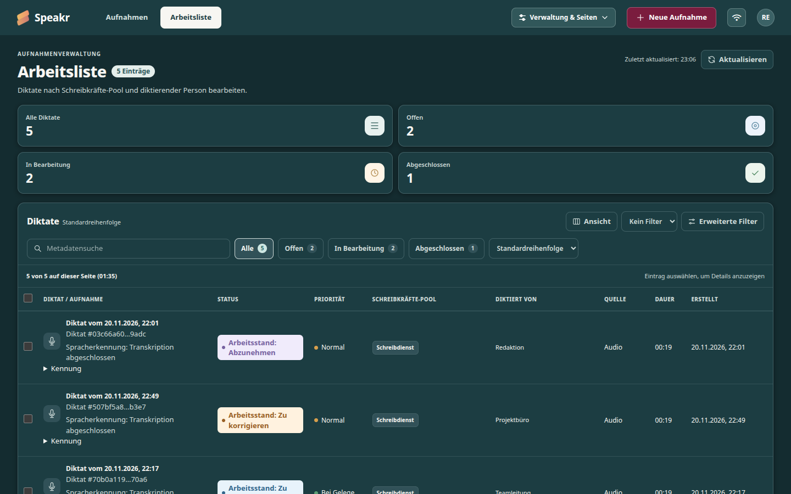
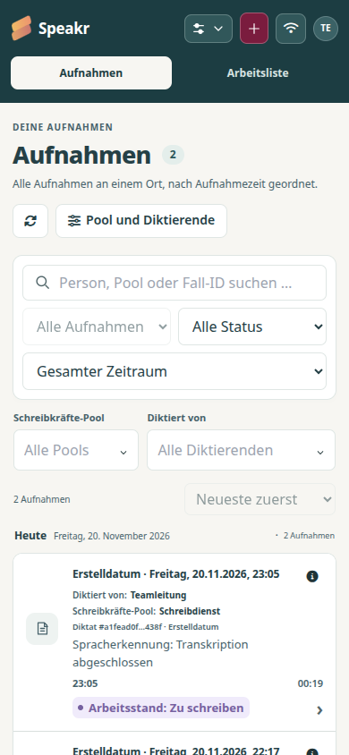

# Ein Diktat in drei Ansichten

[English](../screenshots.md)

Die Bilder zeigen eine synthetische Teambesprechung. Vergleichen Sie in den Ansichten dieselbe Kennung, wenn Sie Rechte oder Arbeitsstände überprüfen.

## Schreibplatz

Über dem Text können Sie abspielen, pausieren oder um fünf Sekunden zurück- und vorspringen. Speichern Sie die Textkorrektur danach. Die Zuordnungszeile nennt den Pool und die aktuelle Bearbeitung.

## Arbeitsliste

Arbeitsstand und Erkennungsstand beschreiben unterschiedliche Vorgänge. Ein vollständig transkribiertes Diktat kann weiterhin auf die Abnahme durch eine Person warten.

## Aufnahmen auf dem Telefon

Ein Druck auf den Titel öffnet die Aufnahme. Fehlt eine Zeile, setzen Sie Pool- und Datumsfilter zurück und prüfen Sie den Sichtbereich des Kontos. So lassen sich die Ansichten mit einem [ersten Diktat](getting-started.md) selbst nachvollziehen.

## Wiedergabe und Korrektur in Bewegung

[Wortmarkierung während der Wiedergabe ansehen (GIF)](../images/clinic/wiedergabe-mit-wortmarkierung.gif). Verfolgen Sie das markierte Wort und die zugehörige Tonposition.

[Textkorrektur ansehen (GIF)](../images/clinic/text-korrigieren.gif). Vergleichen Sie das Wort mit dem Ton und speichern Sie die Änderung. Das Desktop-Standbild oben zeigt die Bedienelemente ohne Animation.

Originalreferenz zu Upstream-Speakr: [archivierte Upstream-Seite](https://github.com/murtaza-nasir/speakr/blob/039a19b1f1c7f0ddaeac0a49b806845626f48a6c/docs/screenshots.md).
