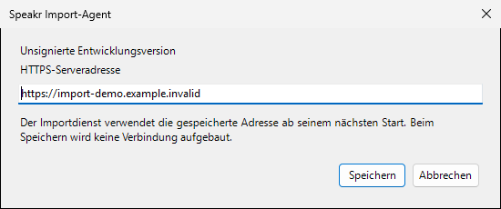
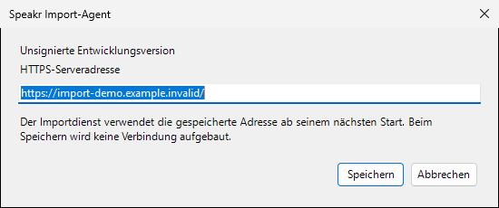

# Mobilzugriff und Geräteimport

[English](../../user-guide/companion-apps.md) · Deutsch

Öffnen Sie auf Telefon oder Tablet die HTTPS-Adresse Ihrer Klinik direkt im unterstützten Browser. Wählen Sie **Neue Aufnahme**. Nutzen Sie **Aufnehmen** mit erteilter Mikrofonfreigabe oder **Datei hochladen** für eine vorhandene zugelassene Audiodatei. Sichern Sie den Entwurf und prüfen Sie die Bestätigung, bevor Sie ihn an den Schreibdienst einreichen.

Für ein zugelassenes Diktiergerät öffnen berechtigte Personen **Verwaltung & Seiten → Dateien und Geräteimport**. Der separate Windows-Importer liest genehmigte Quellen und überträgt Dateien über einen registrierten Importkanal. Das Gerät oder ein Importeintrag allein belegt die diktierende Person nicht. Einen ungeklärten Import melden Sie der zuständigen Stelle.

## Windows-Importagent

Version `windows-import-v0.11.1-preview.1` ist eine unsignierte Testversion für Windows x64. Sie ist für die Erprobung vorgesehen und hat keine klinische Produktivfreigabe.

Der Importagent überträgt Dateien von freigegebenen Geräten und Ordnern unverändert an Ihre Klinik. Laden Sie die [Windows-x64-EXE](https://github.com/joehomeskillet/speakr/releases/download/windows-import-v0.11.1-preview.1/Speakr-Import-win-x64-preview.exe) und die [zugehörige SHA-256-Prüfsumme](https://github.com/joehomeskillet/speakr/releases/download/windows-import-v0.11.1-preview.1/SHA256SUMS.txt) aus derselben Version herunter.

1. Öffnen Sie PowerShell im Downloadordner und führen Sie `Get-FileHash -Algorithm SHA256 .\Speakr-Import-win-x64-preview.exe` aus. Vergleichen Sie alle 64 Stellen unter **Hash** mit der Prüfsumme für diese Datei.
2. Legen Sie die geprüfte EXE in einen beschreibbaren Ordner und öffnen Sie sie per Doppelklick. Im Fenster **Speakr Import-Agent** tragen Sie unter **HTTPS-Serveradresse** die von Ihrer Klinik mitgeteilte Adresse ein und wählen **Speichern**.
3. Falls **Zielserver bestätigen** erscheint, prüfen Sie Adresse und Station. Bestätigen Sie den vorgesehenen Wechsel ausdrücklich. Bei **Nein** bleibt die bisherige Einstellung in Kraft.

Für den reinen Dialogtest genügt ein eigener Ordner. Wird der Agent als Dienst betrieben, dürfen nur berechtigte Betreiber in den Installationsordner schreiben.

Die Einstellung wird als `import-server.json` neben der EXE gespeichert. Zum erneuten Öffnen des Dialogs können Sie in PowerShell `.\Speakr-Import-win-x64-preview.exe --configure` aufrufen.

Die Adresse lässt sich auch vor der Registrierung eingeben. Nach einer neuen Stationszuordnung muss das Ziel erneut bestätigt werden. Die zuständige Stelle muss den Agenten registrieren, sein Clientzertifikat bereitstellen und die vorgesehenen Quellen freigeben.

Die von der Originalversion aufgeführten mobilen Begleitapps sind eigenständige Projekte. Für den Klinikablauf genügt der Browser. Der Windows-Importer ist auf den Dateiimport beschränkt. Aufnahme, Wiedergabe, Textkorrektur und Prüfung erfolgen im Webclient.

[Handbuch der Originalversion](https://github.com/murtaza-nasir/speakr/blob/039a19b1f1c7f0ddaeac0a49b806845626f48a6c/docs/user-guide/companion-apps.md)
