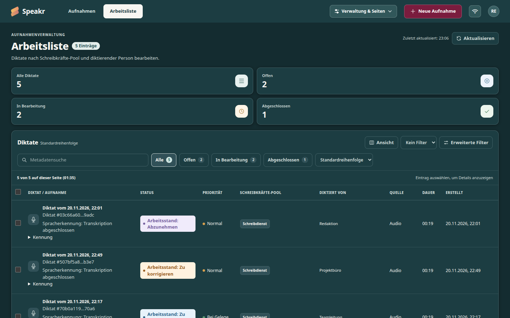
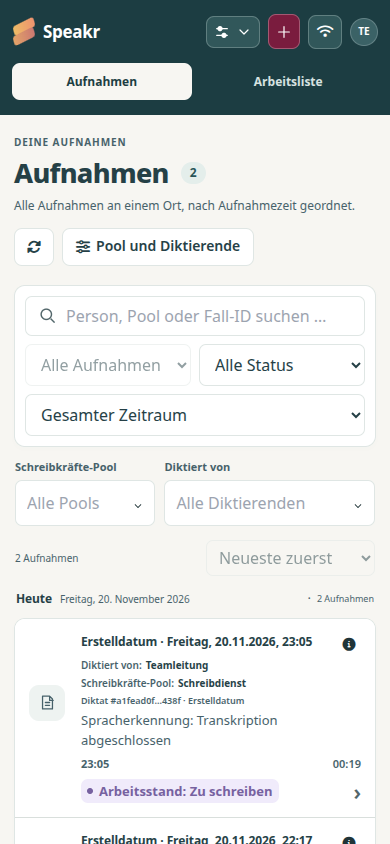

# A dictation in three views

[Deutsch](de/screenshots.md)

The screenshots use a synthetic recording of a team meeting. Follow the same recording identifier between views when comparing permissions or workflow states. The running interface shown here uses German labels.

## Correction workspace

Play or pause above the transcript. Use the two five-second controls to revisit a phrase, then save a correction. The assignment line identifies the pool and current edit holder.

## Worklist

The workflow badge and the recognition status answer different questions. A recording can have a complete transcript and still be waiting for a person to review it.

## Recordings on a phone

Open a recording by its title. If a row is missing, reset the pool and date filters and check the account’s scope. See [first dictation](getting-started.md) to reproduce these views.

## Playback and correction in motion

[Watch word highlighting during playback (GIF)](images/clinic/wiedergabe-mit-wortmarkierung.gif). Follow the selected word and the audio position as playback advances.

[Watch a text correction (GIF)](images/clinic/text-korrigieren.gif). Compare the word with the audio and save the changed revision. The desktop still above shows the controls without animation.

Original reference for upstream Speakr: [archived upstream page](https://github.com/murtaza-nasir/speakr/blob/039a19b1f1c7f0ddaeac0a49b806845626f48a6c/docs/screenshots.md).
