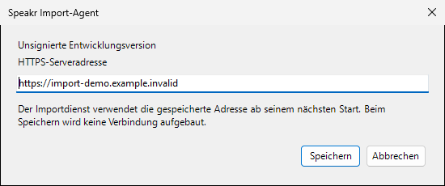
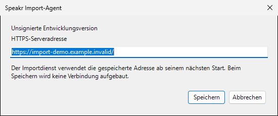

# Phones, browser access and device import

English · [Deutsch](../de/user-guide/companion-apps.md)

On a phone or tablet, open the clinic's HTTPS address directly in its supported browser. Choose **Neue Aufnahme**. Use **Aufnehmen** if the browser has microphone permission, or **Datei hochladen** for an existing permitted audio file. Save the draft and check the receipt before submitting it to the writing service.

For an approved dictation recorder, select **Verwaltung & Seiten → Dateien und Geräteimport** if your role permits it. The separate Windows importer reads approved sources and sends files through a registered import channel. A device or import entry does not identify the dictating person by itself. Report an unassigned import to the responsible operator.

## Windows import agent

Version `windows-import-v0.11.1-preview.1` is an unsigned Windows x64 preview for evaluation. It includes its .NET runtime and has no clinical production approval.

The import agent sends files from approved recorders and folders to your clinic without changing them. Download the [Windows x64 executable](https://github.com/joehomeskillet/speakr/releases/download/windows-import-v0.11.1-preview.1/Speakr-Import-win-x64-preview.exe) and its [SHA-256 checksum](https://github.com/joehomeskillet/speakr/releases/download/windows-import-v0.11.1-preview.1/SHA256SUMS.txt) from the same version.

1. In PowerShell, open your download directory and run `Get-FileHash -Algorithm SHA256 .\Speakr-Import-win-x64-preview.exe`. Compare all 64 characters under **Hash** with the checksum for this file.
2. Move the verified executable to a writable folder and double-click it. In the **Speakr Import-Agent** window, enter the address supplied by your clinic in **HTTPS-Serveradresse** (HTTPS server address) and select **Speichern** (save).
3. If **Zielserver bestätigen** (confirm destination server) appears, check the address and workstation. Confirm the intended change explicitly. Choosing **No** keeps the previous setting.

For a dialog-only test, use a separate portable folder. When running the agent as a service, restrict write access to the installation folder to authorized operators.

Saving the address does not open a connection. The import service reads it at its next start. The setting is saved as `import-server.json` next to the executable. To reopen the dialog from PowerShell, run `.\Speakr-Import-win-x64-preview.exe --configure`.

You can enter the address before registration. Confirm the destination again if the workstation is assigned a new identity. Before a transfer can succeed, your operator must register the agent, provide its client certificate and approve its source folders or devices.

The independent mobile companion apps listed by upstream are separate projects. The clinic browser workflow does not require them. The Windows importer is dedicated to file import. Audio capture, playback, text correction and review belong in the browser.

[Original Speakr guide](https://github.com/murtaza-nasir/speakr/blob/039a19b1f1c7f0ddaeac0a49b806845626f48a6c/docs/user-guide/companion-apps.md)
